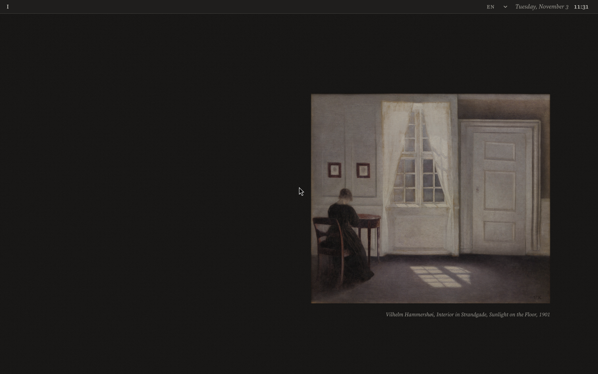
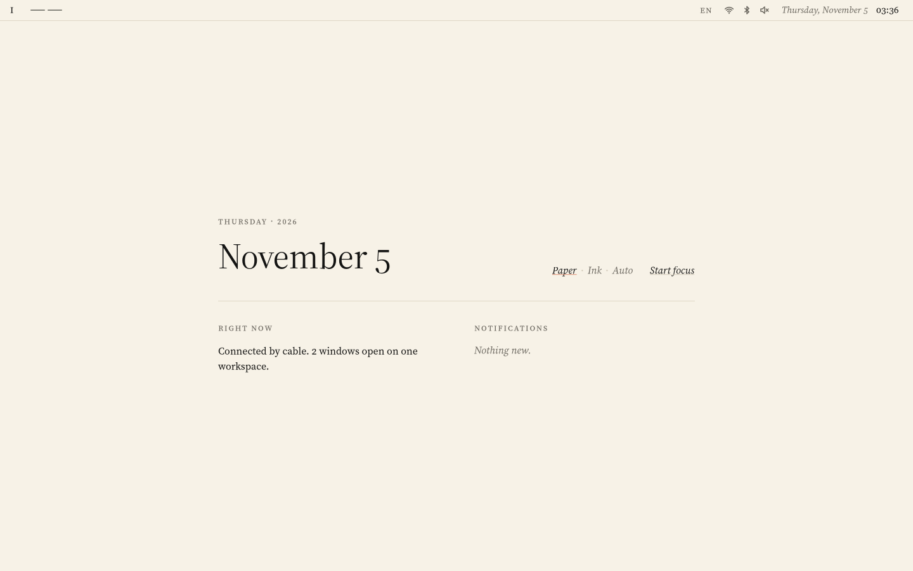

# Recto

**A Linux desktop as quiet as paper.**

English · [中文](README.zh-CN.md)

<p>
  
  
</p>

Recto is an open-source Wayland desktop: [niri](https://github.com/YaLTeR/niri) as the compositor, a small shell of its
own (bar, notifications, search, a Today page, lock screen) and one theme across everyday apps.

## What it wants to be

- **Warm and restrained**: warm white paper and warm black, one accent colour (clay). The look borrows from
  Anthropic's simple style, without its logo, name or commercial fonts.
- **Not geeky**: no walls of icons, no live graphs, no neon. Text first; quiet most of the time, it speaks up only
  when something needs you.
- **Texture kept**: translucent terminals, soft shadows, hairlines: the things that make a desktop pleasant stay, used
  as material rather than as effects.
- **Light on memory**: the whole shell is one process; panels are created on demand and freed when closed. Every
  memory figure comes with how it was measured, not just "lightweight".

The interface is in English; rendering of other languages is handled separately.

## Where it stands

Phases 0–3 are done and most of phase 4; a second day went into motion, material and typography. All of it was
verified in a test virtual machine:

- The theme system generates, installs and switches Paper and Ink live, or switches by time of day (Auto).
- The shell, `recto-shell`, provides:
  - the bar, the Today page (with Now playing) and search;
  - notifications, volume and brightness indicators, focus mode;
  - the tray, an input-method indicator and a microphone-in-use notice;
  - Wi‑Fi, Bluetooth and sound marks that stay in the bar, each opening a short list.

  Idle, the shell takes about 25 MiB PSS (51 MiB RSS); the whole desktop idles at about 174 MiB (PSS, including the
  audio service and the polkit agent).
- The style is a classical book page, not floating cards: serif text, small-capital running heads, old-style
  figures, clay rubrics; the Today page is one whole page, the lock screen a title page; the wallpaper can be your
  own line drawing (a "plate").

The author has used Recto as their daily desktop since November 2026; the formal real-hardware checklist
([docs/TESTING.md](docs/TESTING.md)) has not been completed in full yet.

Screenshots are in [docs/screenshots/](docs/screenshots/); details in [STATUS.md](STATUS.md).
The project documents are in Chinese; the interface, code comments and tokens are in English.

## Requirements

Arch Linux (the installer installs missing packages with pacman). On other distributions install the equivalents
yourself and run `./install.sh --no-packages`; [the theme system](docs/THEMES.md) says what each package is for.

- Required: niri, foot, swaybg, swaylock, swayidle, librsvg, python, libpulse, gtk4, gtk4-layer-shell, rust,
  adobe-source-serif-fonts, inter-font, otf-monaspace, mako, fuzzel.
- Suggested (`./install.sh --with-suggested` adds them): adw-gtk-theme, qt6ct, polkit-gnome, upower, networkmanager,
  fcitx5, xdg-desktop-portal-gnome, xdg-desktop-portal-gtk, xwayland-satellite, wireplumber, brightnessctl,
  noto-fonts-cjk, fastfetch.

## Switch to Recto, or back

You switch yourself; the script never does it for you:

```sh
git clone https://github.com/Cho155/recto.git
cd recto
./install.sh --dry-run    # look first: which packages are missing, which files would change (changes nothing)
./install.sh              # switch to Recto: builds the shell (a few minutes), renames existing configs as backups, asks once, installs
./install.sh --uninstall  # switch back: removes Recto's files, puts back the backed-up configs and GNOME settings
```

Either way, **log out and back in** for the change to be complete. When you install from your current desktop, niri
takes Recto's colours and shortcuts at once, but the old bar and wallpaper keep running; after logging in again it is
all Recto (bar, wallpaper, screen off when idle and lock before sleep). To update, `git pull` and run `./install.sh`
again.

- Backups are named `*.recto-backup-<time>` and sit next to the originals.
- Your own niri settings (outputs, keyboard layout) go in `~/.config/niri/local.kdl`, which the installer never
  overwrites.
- The default wallpaper is a painting by Hammershøi; to use another picture see
  [design/plates/README.md](design/plates/README.md).

More in [the theme system](docs/THEMES.md); to try it on real hardware, follow [the checklist](docs/TESTING.md).

## Shortcuts

If you forget, press **Super+Shift+/**: the common shortcuts appear on screen (niri's own list, with Recto's
descriptions). Super is the Windows key. The Wi‑Fi, Bluetooth and sound marks on the right of the bar can also be
clicked.

| Keys | Action |
| --- | --- |
| Super+Enter or Super+T | Open a terminal |
| Super+Space or Super+D | Search apps and actions |
| Super+A | Today page: notifications, theme (Paper · Ink · Auto), focus mode |
| Super+N | Wi‑Fi: on or off, nearby networks, connect |
| Super+B | Bluetooth: on or off, paired devices, find new devices |
| Super+S | Sound: volume, mute, output and input devices |
| Super+Shift+T | Switch between Paper and Ink |
| Super+Alt+L | Lock the screen |
| Super+Q | Close the window |
| Super+O | Overview of all windows |
| Super+← → or Super+H L | Go to the column on the left or right |
| Super+↑ ↓ or Super+K J | Previous or next window in the same column |
| Super+Ctrl+arrow keys | Move the column or window |
| Super+1 … 9 | Go to workspace 1 to 9 |
| Super+Ctrl+1 … 9 | Move the current column to workspace 1 to 9 |
| Super+Page Down / Page Up, or Super+U / I | Next or previous workspace |
| Super+R | Cycle through preset widths |
| Super+F / Super+Shift+F | Column at full width / window fullscreen |
| Super+- / Super+= | Column narrower / wider |
| Super+C | Center the current column |
| Super+[ / ] | Move the window into the column on the left or right (out of it, if already in one column) |
| Super+W | Stack a column's windows as tabs |
| Super+V | Float the window, or tile it again |
| PrtSc | Screenshot a selection; Ctrl+PrtSc the whole screen, Alt+PrtSc the current window (saved in `~/Pictures/Screenshots`) |
| Super+Shift+P | Turn the displays off |
| Super+Shift+E | Log out |

## Documents (in Chinese)

| Document | Contents |
| --- | --- |
| [Vision](docs/VISION.md) | Why, the core ideas, what it will not do |
| [Design language](docs/DESIGN-LANGUAGE.md) | Colour, type, shape, motion, icons, wording |
| [Architecture](docs/ARCHITECTURE.md) | Components, technology choices, the memory budget and how it is measured |
| [Roadmap](docs/ROADMAP.md) | The phases and what finishes each one |
| [Decisions](docs/DECISIONS.md) | Decisions made, with reasons |
| [Theme system](docs/THEMES.md) | How the tokens become each app's config, installing and removing, switching |
| [Real-hardware checklist](docs/TESTING.md) | What to try item by item on real hardware for the first version, and `tools/collect-report` |
| [Interaction](docs/INTERACTION.md) | How notifications, indicators, the tray and focus mode behave (phase 3) |
| [Design tokens](design/tokens.toml) | The single source of every colour, size and radius (draft) |
| [Specimens](design/specimen/) | Static designs of the desktop, bar, Today page, palette and type |

## License

[MIT](LICENSE). The plates shipped with the project keep their own licences, listed in
[design/plates/README.md](design/plates/README.md).
